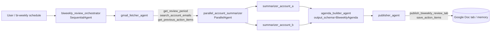

# Agent_01 — Bi-weekly Review Agent

An ADK multi-agent system that turns two weeks of customer email into a
grounded achievement summary and a focused manager 1:1 agenda, published as a
new tab in a Google Doc every two weeks.

## Problem
Preparing a bi-weekly 1:1 means manually scanning dozens of customer emails
across multiple accounts. It is slow, and wins, risks and follow-ups get missed.

## Solution
Agent_01 fetches the last 14 days of labeled email per account, summarizes each
account in parallel with strict schemas, builds a 30-minute agenda that
includes follow-ups from the previous cycle, and publishes it as a dated tab.

Track: **Enterprise Agents**.

## Architecture


| Rubric area | Where in code |
|---|---|
| Tool & Interface Design | `agent_01/tools/*` — specific names, full docstrings, Pydantic schemas (`schemas.py`), `recovery_hint` on every error |
| Context & Memory | `prompts.py` constitution; session state via `output_key`; **events compaction** (`App(events_compaction_config=...)`); **persistent memory** in Firestore (`memory_tools.FirestoreStore`) + **semantic memory** via ADK MemoryService / Vertex AI Memory Bank (`preload_memory`, `add_session_to_memory`); **async background writes** (`save_action_items`) |
| Orchestration & Logic | `agent.py` — Sequential + Parallel agents, structured outputs; **strategic model routing** (fast model for extraction, `gemini-3.1-pro-preview` for agenda reasoning); **human-in-the-loop** confirmation before publishing (`FunctionTool(require_confirmation=True)`); PII guardrail callback |
| Observability & Tracing | `observability.py` — JSON logs, tool latency, privacy guardrail callback, Cloud Trace exporter |
| Infrastructure & CI/CD | `tests/` + `tests/eval/` golden set; GitHub Actions (lint, privacy scan, tests, `terraform validate`); **Terraform IaC** (`infra/terraform`: APIs, least-privilege SA, Secret Manager, Firestore, Cloud Run, Cloud Scheduler); **Secret Manager** OAuth loading (`tools/google_auth.py`); `Dockerfile` |

## Memory options
- Default: local JSON (`memory_backend: "json"`).
- Persistent: `AGENT01_MEMORY_BACKEND=firestore` (database created by Terraform).
- Semantic: `adk web --memory_service_uri=agentengine://<agent_engine_id> .`

## Human approval
Publishing to the shared Google Doc pauses for your confirmation in `adk web`.
For unattended runs set `AGENT01_REQUIRE_CONFIRMATION=false`.

## Infrastructure
```bash
cd infra/terraform
terraform init
terraform apply -var="project_id=<project>" -var="image=<artifact-registry-image>"
```

## Privacy by design
- Customers are only ever called `ACCOUNT_A` / `ACCOUNT_B`. The real label
  mapping lives in git-ignored `config.local.json`.
- The public demo uses synthetic emails (`agent_01/data/synthetic_emails.json`).
- A `before_tool_callback` blocks tool calls that contain real customer names.
- CI runs a denylist scan driven by a GitHub secret.

## Quick start (demo mode)
```bash
python -m venv .venv && source .venv/bin/activate
pip install -e ".[dev]"
cp agent_01/.env.example agent_01/.env   # set GOOGLE_CLOUD_PROJECT
gcloud auth application-default login
pytest -q
adk web .          # open the UI, select agent_01
# or: adk run agent_01
adk eval agent_01 tests/eval/demo.evalset.json
```
Demo output is written to `outputs/<date>_Bi-weekly_Review.md`.

## Live mode (local only)
1. `pip install -e ".[live]"`
2. Create an OAuth Desktop client, save as `credentials.json` (git-ignored).
3. Create `config.local.json` from `config.example.json` with your real Gmail
   labels, `"mode": "live"` and your Google Doc ID.
4. `adk run agent_01` — first run opens the OAuth consent screen.

## Scheduling
Run every other Monday, e.g. cron:
`0 9 * * 1 [ $(( $(date +\%V) \% 2 )) -eq 0 ] && cd ~/Agent_01 && adk run agent_01 <<< "Prepare my bi-weekly review"`

## Deploy
`GOOGLE_CLOUD_PROJECT=<project> scripts/deploy.sh` (Cloud Run, demo mode).
